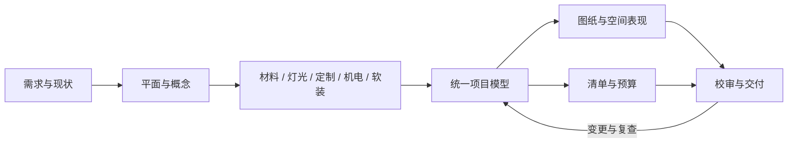

# 室内设计全流程 · 15 Skills v2

[GitHub 仓库](https://github.com/zlcting/interior-design-skills) · [自动检查](https://github.com/zlcting/interior-design-skills/actions/workflows/validate.yml)

用统一项目数据衔接需求、测量、平面、概念、空间表现、材料、灯光、定制、机电、图纸、软装、预算、校审和交付配合。

15个可独立安装的 Skills、共享项目模型、二维出图与预算工具，以及两个可浏览的项目案例。


v2新增[折庭84㎡ L形跨户型测试](projects/TEST-L-084/README.md)：通用二维工具支持正交凹轮廓、偏移坐标、任意对象编号、显式柜体正面、材料铺装及可选设备。一次衣柜变更已贯通图纸、清单与26行预算。原96㎡示范交付与历史执行记录保持冻结。详见[复用升级与价值验证](docs/复用升级与价值验证.md)。

## 快速使用

```bash
git clone https://github.com/zlcting/interior-design-skills.git
cd interior-design-skills
python3 install.py --target ~/.codex/skills
python3 install.py --target ~/.codex/skills --check
```

安装器先检查全部同名目录，存在冲突时不写入；不会覆盖其他技能。安装后在新会话使用：

更新本项目已安装版本时，可用`python3 install.py --update-from <上次交付包根目录> --target ~/.codex/skills`。只有安装内容与已知旧版或当前主版本字节一致时才更新；任何本地改动/未知内容均停止。旧文件保留在目标父目录的`interior-skill-backups`，更新失败自动恢复已替换目录。

```text
使用 $interior-orchestrator 完成 <项目目录> 的室内设计。
项目类型<住宅/办公/酒店/商业>，城市<城市>，使用人数<人数>，
面积口径<口径>，预算<金额与包含范围>，资料<平面/尺寸/照片>。
先整理输入与未知项，再提出平面方案，按阶段完成图纸、清单与校审。
```

## 从户型图片生成 CAD 和三维户型

以下步骤适合直接与 Agent 对话使用。`interior-orchestrator` 负责协调所需环节，不必每次分别调用全部15个技能。只要生成CAD或三维模型时，可以明确本轮交付范围。

### 1. 准备项目资料

新建一个项目文件夹，将户型图片、已有CAD、尺寸标注或现场照片放进去，并在对话中提供项目文件夹路径。最好同时说明需要生成什么、保存在哪里，以及是否允许新增家具布局。

只有图片时，优先使用图片中的明确尺寸；未标注的门窗尺寸、层高、窗台高等应单独记录为估算、建模假设或待核实项。原图面积与重绘几何不一致时保留差异，不为了凑面积移动墙线。没有场地资料时，先确认是否开展示范，不自动套用案例户型。

### 2. 先生成可编辑 CAD

示例提示词（将路径替换成自己的项目目录）：

```text
使用 $interior-orchestrator，读取 /path/to/project 中的户型资料，
生成可编辑CAD户型图，并保存到这个项目文件夹。
按原图标注尺寸重绘墙体、门窗、房间名称和尺寸，保留原始图片。
未标注尺寸单独标明估算依据；本轮不做布局改造。
同时提供DXF、PNG预览和SVG，将主要文件放在文件夹顶层，
完成后告诉我具体文件名，并直接显示预览图。
```

DXF是可编辑CAD交换格式，用支持DXF的CAD软件打开；PNG用于直接预览；SVG可在浏览器中放大查看。尺寸单位为毫米，CAD模型空间为1:1。尺寸标注可能由独立线条与文字组成，交付时应说明是否为可关联更新的尺寸对象。生成图纸不等于完成现场实测或施工审签。

### 3. 基于同一户型生成三维模型

生成前明确两个独立选择：家具精细度（基础体块或精细家具）与表现风格（极简白模、日式自然、意式现代、中古复古或参考方向）。也可以明确只建墙体门窗，家具细化不适用。已有明确选择时沿用，不必重复确认；未明确时先询问。

本次使用的“精细家具＋极简白模”可这样请求：

```text
使用 $interior-orchestrator，基于 /path/to/project 现有户型模型，
生成精细家具＋极简白模的三维户型，沿用已有墙体和门窗位置。
允许增加家具布局意向，所有新增家具和缺失的竖向尺寸单独记录来源。
先检查一个代表房间，再用相同细节层级完成全屋。
交付可编辑Blender源文件、通用GLB模型、全屋及代表房间预览，
并生成内嵌引擎和模型、无需CDN的独立HTML查看页面。
主要入口和预览另存到项目文件夹顶层，明确列出实际文件名。
```

“精细家具”需要实际调用家具细化模块，并列出已细化对象与仍为基础造型的对象。当前白模支持沙发软包、抱枕、床品、茶几支脚及可识别设备等细节；不能据此声称所有家具都已达到精细产品模型水平。其他风格须按现有家具库支持范围说明，不能静默改用白模。新增家具属于方案意向，不自动成为已批准的选品或采购。

### 4. 白模网页明确采用 white-home3d-v1

`white-minimal` 是表现风格，`refined` 是家具精细度，`white-home3d-v1` 是白模网页/Home3D的光影交付预设，三者作用不同。当前总控流程对新白模网页默认采用该预设，也可以在提示词里明确写出：

```text
网页使用 white-home3d-v1 预设，锁定预设版本和哈希，
按本户型适配相机、主光、补光和阴影范围。
将接触AO实际烘焙到网页模型，保留玻璃透射和已有局部暖灯。
重新导入GLB核对求值几何，检查独立HTML内嵌的模型与最终网页GLB一致。
分别记录几何检查、视觉检查、网页交互和用户批准状态。
交付时说明独立GLB与HTML内嵌模型是否同为AO优化后的版本。
```

该预设负责网页的主/补光、曝光、色调映射、抗锯齿和阴影规则；接触AO写入模型顶点颜色，使家具落地处、缝隙和转角在网页中保留层次。它不会自动把基础家具变成精细家具，也不会新增正式工程灯位。可开关局部灯的照明不烘死到模型里。

离线效果图使用白模风格对应的Cycles/AgX设置，网页使用实时预设，两者的曝光和光强数值不能直接照搬；需要同相机对照检查，不能承诺像素完全一致。详细依据见[家具精细度与风格选择](skills/interior-orchestrator/references/3d-selection.md)、[白模光影交付标准](skills/interior-orchestrator/references/white-render-standard.md)和[三维交换与网页验收](skills/interior-visualization/references/exchange-acceptance.md)。

### 5. 打开成果和检查交付

在Mac上，用访达进入项目文件夹，右键实际交付的`.html`文件，选择“打开方式 → Google Chrome”。独立页面已内嵌引擎、模型和配置，不需要Node服务或CDN；仍需要浏览器支持WebGL。通常可左键拖动旋转、滚轮缩放、右键拖动平移，并使用页面提供的视角、复位和局部灯光按钮。

| 文件 | 用途与区别 |
|---|---|
| `*.dxf` / `*.svg` / `*.png` | 可编辑二维CAD、矢量平面和图片预览 |
| `interior.blend` | 可编辑三维源场景；交付说明应注明完整墙高和剖切集合 |
| `interior.glb` | 三维渲染阶段导出的通用模型，默认不包含后续网页AO烘焙 |
| `white-web.glb` | 网页阶段经过接触AO处理并重新导入校验的模型 |
| `打开精细白模.html` | 默认网页文件名，内嵌网页模型与引擎；可按项目约定另存入口名称 |
| `white-render-config.json` | 预设ID、版本、哈希，以及本户型派生的光影与相机配置 |
| `exchange-validation.json` / `white-web-validation.json` | 三维导出与网页AO处理后的几何回读检查 |
| `white-viewer-manifest.json` | 来源、输出哈希及实际验收状态 |

不要只看文件是否存在：核对是否为同一户型、门窗与家具是否一致、导出的软包和圆角是否保留，以及网页实际模型是否就是优化后的版本。原始GLB和网页AO模型不能混称；若用户需要优化后的独立模型，应额外交付`white-web.glb`或其明确命名副本。

网页直开（`file://`）、HTTP预览、桌面/窄屏、旋转缩放、视角切换和灯光开关应分别记录测试结果。工具限制导致未测试时明确标记，不把脚本语法或几何检查通过写成视觉/交互验收通过。特殊凹轮廓还需检查地面、底座和门槛覆盖，二维轮廓支持不自动代表三维渲染已完整适配。

### 命令行生成白模网页（已有完整项目模型）

以下命令从仓库根目录运行，需要Python、项目依赖和可正常运行的Blender。输入须已包含家具语义、材料、层高、门窗和本户型相机；其中需有名为`axon`的轴测相机。命令不会从一张图片自动补齐这些数据。

```bash
PROJECT_DIR="/path/to/project"

# 先检查家具、风格与相机输入，不生成文件。
python3 skills/interior-orchestrator/scripts/render_project.py "$PROJECT_DIR" \
  --style white-minimal --view axon --check-only

# 生成精细几何、离线预览、Blender/GLB，并执行交换几何检查。
# 精细选择须已写入项目模型：style_id=white-minimal、furniture_detail=refined。
blender -b -t 4 --python-exit-code 1 \
  --python skills/interior-orchestrator/scripts/render_project.py -- "$PROJECT_DIR" \
  --style white-minimal --view axon --device auto \
  --out "$PROJECT_DIR/visuals/white-minimal-v1"

# 由同一模型和GLB生成AO优化后的网页模型与独立HTML。
python3 skills/interior-orchestrator/scripts/prepare_white_viewer.py "$PROJECT_DIR" \
  --glb "$PROJECT_DIR/visuals/white-minimal-v1/interior.glb" \
  --out "$PROJECT_DIR/visuals/white-web-v1"
```

项目选择应记录在`model/project.json`的`visualization.style_id`、`visualization.furniture_detail`与`visualization.selection_source`。白模网页预设可显式记录为`visualization.white_render_profile: "white-home3d-v1"`。已有同源解析计划时可用`--plan`传给网页工具；用`--room <房间编号>`选择代表房间，或用`--blender <可执行文件路径>`指定Blender。

网页输出目录必须为空；重做时使用新的版本目录，保留上一版。上述命令使用工具默认文件名，文件夹顶层的简短入口属于额外的交付整理。出现GPU初始化、导出上下文或浏览器限制时，记录实际失败与恢复步骤，不将未完成的检查记为通过。

## 技能目录

| Skill | 工作 |
|---|---|
| [interior-orchestrator](skills/interior-orchestrator/SKILL.md) | 总控、阶段与版本 |
| [interior-brief](skills/interior-brief/SKILL.md) | 需求、任务书与预算范围 |
| [interior-survey](skills/interior-survey/SKILL.md) | 现状、测量与开口基线 |
| [interior-layout](skills/interior-layout/SKILL.md) | 平面、家具和动线 |
| [interior-concept](skills/interior-concept/SKILL.md) | 概念、色彩和材质方向 |
| [interior-visualization](skills/interior-visualization/SKILL.md) | 同源模型、相机与空间表现 |
| [interior-finishes](skills/interior-finishes/SKILL.md) | 材料、铺装和收口 |
| [interior-lighting](skills/interior-lighting/SKILL.md) | 灯位、灯具和控制 |
| [interior-joinery](skills/interior-joinery/SKILL.md) | 柜体、木作和五金 |
| [interior-mep](skills/interior-mep/SKILL.md) | 设备与专业接口 |
| [interior-drawings](skills/interior-drawings/SKILL.md) | 平立剖、图集与CAD |
| [interior-ffe](skills/interior-ffe/SKILL.md) | 家具、软装与采购准备 |
| [interior-cost](skills/interior-cost/SKILL.md) | 工程量、估算与变更费用 |
| [interior-review](skills/interior-review/SKILL.md) | 校审、问题与复查 |
| [interior-delivery](skills/interior-delivery/SKILL.md) | 交底、模板和交付包 |

共享契约在 `skills/interior-orchestrator/references/project-contract.md`，各技能有独立阶段检查表。真实项目规范适用性需依据具体地区、用途和官方文本确定；本套件不内置未经核验的法定阈值。



## 已执行项目

[栖木之家](projects/DEMO-APT-096/README.md)：用户选定的96㎡住宅示范，两卧加书房、三口之家、原木浅色。完整设计资料在项目目录，包含PDF图集、6张SVG、一份可编辑DXF、三张同源渲染、Blender/GLB模型、预算工作簿和各类CSV。

输入尺寸及单价是示范设定；交付状态为设计文件与现场配合准备。未虚构实测、询价、采购、施工或现场验收。

| 案例 | 图集 | 预算 | 可编辑图纸 |
|---|---|---|---|
| [栖木之家 · 96㎡](projects/DEMO-APT-096/README.md) | [12页PDF](projects/DEMO-APT-096/documents/栖木之家_方案与深化图集.pdf) | [XLSX](projects/DEMO-APT-096/schedules/栖木之家_预算.xlsx) | [DXF](projects/DEMO-APT-096/drawings/interior-set.dxf) |
| [折庭 · 84㎡ L形测试](projects/TEST-L-084/README.md) | [8页PDF](projects/TEST-L-084/documents/折庭_图集.pdf) | [XLSX](projects/TEST-L-084/schedules/折庭_预算.xlsx) | [DXF](projects/TEST-L-084/drawings/interior-set.dxf) |

## 数据与复算

```bash
python3 skills/interior-orchestrator/scripts/project_tools.py check projects/DEMO-APT-096/model/project.json --out /tmp/interior-check.json
python3 skills/interior-orchestrator/scripts/project_tools.py schedules projects/DEMO-APT-096/model/project.json --out projects/DEMO-APT-096/schedules
```

工程量规则在预算行的 `quantity_rule` 中；地面、顶面、柜体、部分家具计数随模型更新，墙面/机电暂估保留来源。采购量先四舍五入到四位小数，再乘单价并四舍五入到分；预备费只计一次。

绘图与文件检查：

```bash
python3 -m venv .venv
.venv/bin/python -m pip install -r requirements.txt
.venv/bin/python skills/interior-orchestrator/scripts/export_drawings.py projects/TEST-L-084
.venv/bin/python skills/interior-orchestrator/scripts/export_pdf.py projects/TEST-L-084 --previous projects/TEST-L-084/history/v1.0
.venv/bin/python skills/interior-cost/scripts/export_budget.py projects/TEST-L-084
.venv/bin/python skills/interior-review/scripts/verify_2d.py projects/TEST-L-084 --check-records
.venv/bin/python -m unittest discover -s tests -v
blender -b -t 4 --python skills/interior-orchestrator/scripts/render_project.py -- projects/DEMO-APT-096
```

通用PDF使用`export_pdf.py`；`tools/build_book.py`仅重建原96㎡案例的12页汇报，其原绘图实现由`releases/baseline-v1-tools.zip`冻结。原案例配对DXF源码也属于v1冻结资源，需在v1交付包/对应环境中使用。中文字体从`INTERIOR_PDF_FONT`指定的TrueType文件读取，macOS默认尝试Arial Unicode，PDF内嵌字体子集。

预算工具已随interior-cost安装；`export_budget.py`在临时目录链接Codex工作区的 `@oai/artifact-tool`，可显式传入--node与--modules。`tools/build_budget.mjs`保留为兼容入口。非Codex环境可直接使用CSV、现有工作簿和标准库复算工具。没有模型服务或API Key依赖。

`verify_2d.py`为通用户型核验器，读取真实图纸、工作簿及清单，独立重算预算。`tools/verify_change.py`验证本次衣柜变化及陈旧模型拒绝。`tools/verify_delivery.py --baseline-skills --out validation/demo096-regression-v2.json`专用于原96㎡冻结交付，按v1技能快照核对原15项记录、原三维、图纸和40行预算；不会把原记录冒认为由v2技能生成。

具体已执行检查见 `VALIDATION.md`；技能格式校验不替代设计行为验证，示范设计也不等同真实工程施工成果。


## 多风格家具库

提供四套风格、16款参数化资产与显式家具类型：风格选择同时影响家具轮廓、柜门、吊灯及材质参数。用 [STYLE-LAB-096](projects/STYLE-LAB-096/README.md) 查看四风格及白模v4结果；字段、命令及扩展方法见[风格与家具库](skills/interior-orchestrator/references/style-library.md)。原96㎡交付及此前配色预览保留。


新增第四种风格 **极简白模 white-minimal**：哑光白灰、蓝色背景、蓝灰玻璃、柔和投影及随相机方向变化的剖切墙体。用同一入口指定 `--style white-minimal`；[四风格对比](projects/STYLE-LAB-096/comparison.html)可查看实际结果。

白模v3增加客厅局部样板：矩形软包沙发、薄边茶几、阔叶植物、透明玻璃和暖光落地灯。查看[客厅样板及同机位前后对比](projects/STYLE-LAB-096/living-refinement.html)；本轮候选独立保存于white-minimal-living-v3，其他房间沿用v2造型。

最新白模v4加强局部明暗、收紧硬质边缘，默认2400×1800、128采样；用`--device auto`可优先使用本机GPU。[总对比页](projects/STYLE-LAB-096/comparison.html)已同步v4；[清晰度前后对照](projects/STYLE-LAB-096/clarity-refinement.html)保留同机位v3参考。
